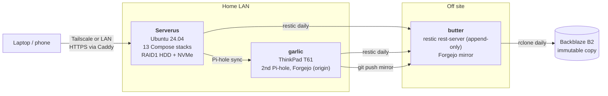

# homelab

Infrastructure as code for my home lab: three Linux machines, 13 Docker Compose stacks, a
host layer managed with Ansible, 3-2-1 backups with restic, and a rebuild procedure that has
been tested end to end on a clean VM.

This is the public copy of my private homelab repo. It is generated by
[`scripts/showcase.sh`](scripts/showcase.sh) (see [How this repo is made](#how-this-repo-is-made)),
so addresses, domains and a few private parts are replaced or left out.

## What this shows

| Area | Where to look |
|---|---|
| **Linux administration**: Ubuntu Server, systemd units and timers, software RAID1 (mdadm), fstab bind mounts, netplan, sshd hardening, systemd-resolved | [`host/`](host), [`ansible/roles/`](ansible/roles) |
| **Configuration management**: idempotent Ansible playbook for the whole host layer, `ansible-lint` production profile, `--check` against the live server reports `changed=0` | [`ansible/`](ansible), [`bootstrap.sh`](bootstrap.sh) |
| **Disaster recovery**: written rebuild order, restore tested on a throwaway VM with the problems it found fixed and logged | [`docs/restore.md`](docs/restore.md), [`scripts/test-vm.sh`](scripts/test-vm.sh) |
| **Backups (3-2-1)**: restic to an append-only rest-server off site, then copies to a second disk and to Backblaze B2 (immutable), health checks and push alerts | [`host/usr/local/bin/restic-backup.sh`](host/usr/local/bin/restic-backup.sh), [`host-butter/`](host-butter) |
| **Containers and networking**: Docker Compose, Caddy reverse proxy with DNS-01 wildcard certificates, Pi-hole DNS (two instances kept in sync), Tailscale with subnet routing and per-device access rules | [`stacks/`](stacks), [`stacks/caddy/Caddyfile`](stacks/caddy/Caddyfile) |
| **Security habits**: secrets never in git (`.env.example` holds names only), gitleaks on every commit and push, services reachable only on the tailnet or home LAN, least-privilege Docker socket proxy | [`scripts/scan.sh`](scripts/scan.sh), [`.gitignore`](.gitignore) |
| **Automation and AI in operations**: nightly jobs written in plain Python/Bash, including a headless Claude Code run with a locked-down tool allowlist | [`tools/`](tools) |
| **Self-hosted Git**: two Forgejo instances, install scripts with checksum and GPG verification, push mirroring between sites | [`host-garlic/`](host-garlic), [`host-butter/`](host-butter) |

## Architecture



Nothing is exposed to the internet. Services have real names under a wildcard certificate
(Let's Encrypt, DNS-01 on Cloudflare) whose DNS records point at the Tailscale address, and
Caddy decides per service whether the tailnet, the whole home LAN or only my own devices get in.

## Machines

| Host | Role |
|---|---|
| **Serverus** | Main server. Docker data root on NVMe, media on a RAID1 array. Everything in [`stacks/`](stacks) runs here. |
| **garlic** | Old ThinkPad T61 given a second life: second Pi-hole and the home Forgejo, which is `origin` for my repos. Install scripts in [`host-garlic/`](host-garlic). |
| **butter** | Off-site box reachable only over Tailscale: restic rest-server for both home machines and a Forgejo mirror. Scripts in [`host-butter/`](host-butter). |

## Stacks

| Stack | What runs |
|---|---|
| [`caddy`](stacks/caddy) | Reverse proxy, own build with the Cloudflare DNS module |
| [`pihole`](stacks/pihole) | DNS for the home network and local names; settings exported as JSON |
| [`homepage`](stacks/homepage) | Dashboard; container status through a read-only Docker socket proxy |
| [`infrastructure`](stacks/infrastructure) | Uptime Kuma (alerts via ntfy), Dockge |
| [`vaultwarden`](stacks/vaultwarden) | Password manager, nightly DB backup with an alert on failure |
| [`jellyfin`](stacks/jellyfin) | Jellyfin media server |
| [`books`](stacks/books) | E-book library (BookOrbit + Postgres) and a small stats bridge for Homepage |
| [`kalorie`](stacks/kalorie) | My calorie tracker app (Symfony; code in [Pan-be/calories.ai](https://github.com/Pan-be/calories.ai)) |
| [`pan-be-staging`](stacks/pan-be-staging) | WordPress staging for my company website |
| [`larapaper`](stacks/larapaper) | TRMNL-compatible server that drives an e-ink dashboard on an old Kindle |
| [`ollama`](stacks/ollama) | Local LLM, CPU only |
| [`crafty`](stacks/crafty) | Minecraft server manager |
| [`board`](stacks/board) | Read-only priorities board rebuilt every 5 minutes from my notes (generator in [`tools/board`](tools/board)) |

## Rebuilding from scratch

```
git clone <this repo> ~/dev/homelab && cd ~/dev/homelab
./bootstrap.sh --check   # dry run
./bootstrap.sh           # ansible-core from apt, then ansible/site.yml
```

The full order (secrets back first, host layer, Tailscale, data from restic, stacks, checks)
is in [`docs/restore.md`](docs/restore.md), together with the log of the VM test: three
playbook bugs found and fixed, 7.6 GiB restored from the off-site box in under 4 minutes.

## Tools

Small programs that keep the lab running, each with its systemd timer or cron line:

- [`tools/vault-tidy`](tools/vault-tidy): nightly headless Claude Code run that tidies my
  notes repo. The wrapper does the risky parts itself (lock, clean-tree check, fast-forward
  pull, refuses to commit non-Markdown changes or a moved HEAD); the model gets a short tool
  allowlist and no prompts. Also a deterministic Python lint and an 08:00 summary push.
- [`tools/board`](tools/board): stdlib-only generator for the board shown on Homepage.
- [`tools/mdadm-ntfy`](tools/mdadm-ntfy): turns `mdadm --monitor` events into push alerts
  (the default `MAILADDR` had no mail transport, so RAID alerts went nowhere).

## How this repo is made

The private repo is the source of truth. `scripts/collect.sh` snapshots the live config into
it; `scripts/showcase.sh` builds this public copy from an allowlist and is fail-closed:

1. Copies only the files listed in a manifest.
2. Replaces addresses with documentation ranges (`192.0.2.0/24`, `100.64.0.x`), domains with
   `example.com`, the user name with `admin`, and disk UUIDs and host-key fingerprints with
   placeholders.
3. Aborts without writing anything if a deny list (real addresses, names, domains) or
   gitleaks matches the result.

Left out on purpose: firewall rules and crontabs (placeholders in [`host/crontab`](host/crontab)),
a friend's trading bot that runs on the same server (its Caddy route is kept as `private-app`),
and personal data feeds. Git history here starts fresh; the private history is not published.
